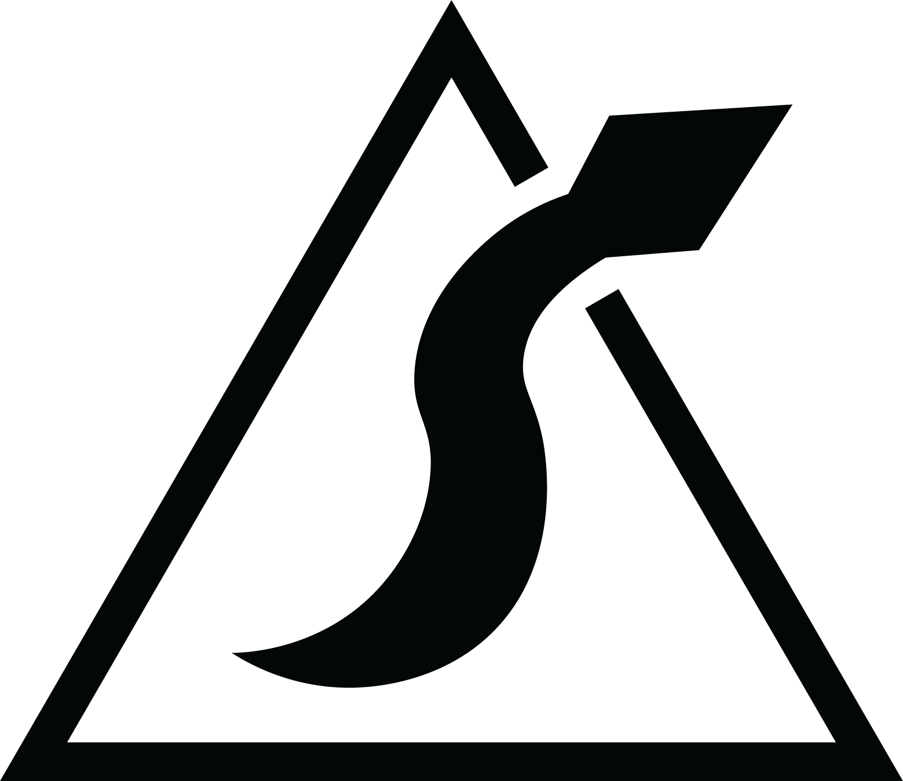
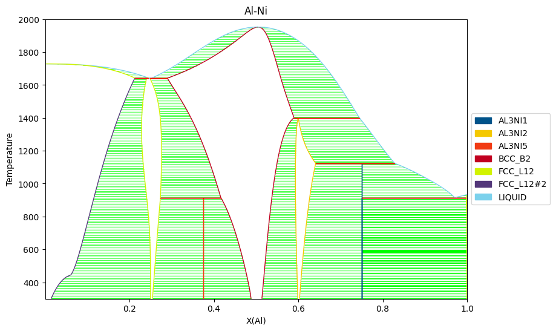

|logo| PyCalphad: Computational Thermodynamics
==============================================

PyCalphad is a free and open-source Python library for
designing thermodynamic models, calculating phase diagrams and
investigating phase equilibria within the CALPHAD method. It
provides routines for reading Thermo-Calc TDB and ChemSage DAT files
and for solving the multi-component, multi-phase Gibbs energy
minimization problem.

The latest development version of the source code can be found on `GitHub`_.
The newest stable version can be found on `PyPI`_.

.. _GitHub: https://github.com/pycalphad/pycalphad
.. _PyPI: https://pypi.python.org/pypi/pycalphad

.. toctree::
   :maxdepth: 1

   INSTALLING
   CHANGES

.. toctree::
   :maxdepth: 2
   :caption: How-to

   examples/1_Phase_Diagrams/index
   examples/2_Computing_Properties/index
   examples/3_High_Throughput_Analysis/index
   examples/4_Metastability_Reference_States/index

.. toctree::
   :maxdepth: 1
   :caption: Reference

   reference/calphad_databases
   reference/faq

.. toctree::
   :maxdepth: 1
   :caption: Developer

   releasing
   developer/onboarding
   developer/contributing
   api/modules

Contributing
------------
Please read the documentation for `contributing to PyCalphad <https://pycalphad.org/docs/latest/developer/contributing.html>`_ before submitting a pull request.

Our `AI policy <https://pycalphad.org/docs/latest/developer/contributing.html#ai-policy>`_ can be found in the contributing guide.

Getting Help
============

Questions about installing and using PyCalphad can be addressed on the `PyCalphad Discussion board <https://github.com/pycalphad/pycalphad/discussions>`_.
Technical issues and bugs should be reported on on `GitHub`_.
A public chat channel is available on `Gitter`_.

.. _Gitter: https://gitter.im/pycalphad/pycalphad

Citing
======

If you use PyCalphad in your research, please consider citing the following work:

Otis, R. & Liu, Z.-K., (2017). pycalphad: CALPHAD-based Computational Thermodynamics in Python. Journal of Open Research Software. 5(1), p.1. DOI: http://doi.org/10.5334/jors.140

Acknowledgements
================
Development has been made possible in part through NASA Space Technology Research Fellowship (NSTRF) grant NNX14AL43H, and is supervised by `Prof. Zi-Kui Liu`_ in the `Department of Materials Science and Engineering`_ at the `Pennsylvania State University`_.

.. _Prof. Zi-Kui Liu: http://www.phases.psu.edu/
.. _Department of Materials Science and Engineering: http://matse.psu.edu/
.. _Pennsylvania State University: http://www.psu.edu/

Indices and tables
==================

* :ref:`genindex`
* :ref:`modindex`
